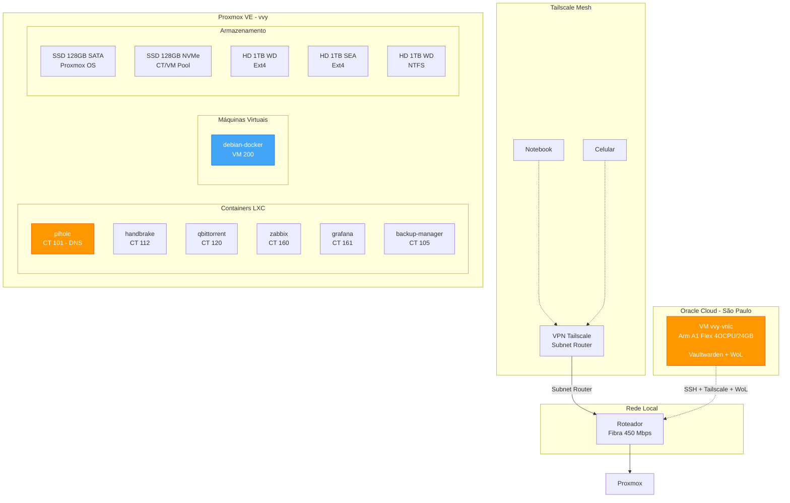

# vvy-homelab

Home lab baseado no **Proxmox VE**, projetado para centralizar serviços de
infraestrutura de rede e armazenamento em nuvem privada. Atua como núcleo
de processamento para tarefas que exigem disponibilidade 24/7, permitindo
que o notebook principal seja utilizado apenas para interface de trabalho
e criação.

---

## Arquitetura do Homelab

---

## Documentação

| Documento                                          | Descrição                                                                                 |
| -------------------------------------------------- | ----------------------------------------------------------------------------------------- |
| [Hardware](docs/hardware.md)                       | Especificações do servidor (Xeon E5-2470 v2, RAM, SSDs) e do cliente                      |
| [Proxmox Setup](docs/proxmox-setup.md)             | Virtualização Proxmox VE 9.2.11, containers LXC e VMs                                      |
| [Storage](docs/storage.md)                         | HDs de dados, pontos de montagem e UUIDs                                                  |
| [Networking](docs/networking.md)                   | VPN Tailscale, nós, subnet router e acesso remoto                                         |
| [Backup](docs/backup.md)                           | Sistema de backup — rclone + Google Drive 2TB (CT 105) e painel [vvy-backup](https://github.com/mviniciusy/vvy-backup) |
| [Monitoring - Zabbix](docs/monitoring-zabbix.md)   | Zabbix 7.2, hosts monitorados e thresholds                                                |
| [Monitoring - Grafana](docs/monitoring-grafana.md) | Grafana 12.4 + Prometheus + Node Exporter                                                 |
| [Scripts](docs/scripts.md)                         | Scripts de telemetria e automação                                                         |
| [Docker VM](docs/docker-vm.md)                     | VM Debian 12 com Docker e Portainer                                                       |
| [Terraform](docs/terraform-proxmox.md)             | Infraestrutura como Código — provisionamento Proxmox                                      |
| [Ansible](docs/ansible-proxmox.md)                 | Configuração como Código — automação de tarefas                                           |
| [Oracle Cloud](oracle/oracle-cloud.md)             | VM vvy-vnic na Oracle Cloud — Arm A1 Flex 4 OCPU / 24 GB (conta PAYG, shape dentro do free), extensão remota do homelab           |
| [OpenBot](docs/openbot.md)                         | OpenBot e OpenCode na VM Oracle — instalação, operação, acesso à casa e pitfalls |
| [BIOS vvy](docs/bios-vvy.md)                       | Configuração completa da BIOS QIYIDA X79 — C-states, power limits, QPI, ACPI              |

---

## Scripts

| Script | Descrição |
|---|---|
| [`scripts/monitoring/server-watchdog.sh`](scripts/monitoring/server-watchdog.sh) | Telemetria do servidor — memória, CPU, disco, rede. Cron a cada 1 min |
| [`scripts/backup/sync_wd1tb.sh`](scripts/backup/sync_wd1tb.sh) | Sync HD-WD-1TB para Google Drive via rclone (cron SEG 03:00) |
| [`scripts/backup/sync_wd500gb.sh`](scripts/backup/sync_wd500gb.sh) | Sync HD-WD500GB para Google Drive via rclone (cron TER 03:00) |
| [`scripts/backup/clean_lixeira.sh`](scripts/backup/clean_lixeira.sh) | Limpeza da lixeira no Google Drive — retenção 14 dias (cron DOM 04:00) |
| [`scripts/server-freeze/`](scripts/server-freeze/) | Kit de diagnóstico de travamento — watchdog, diagnóstico pós-reboot e instalador |
| [`scripts/sync/`](scripts/sync/) | Sincronização privado → público (sync_public.py) |
| [`scripts/monitoring/vvy-healthcheck-unified.sh`](scripts/monitoring/vvy-healthcheck-unified.sh) | Healthcheck + MCE/EDAC unificados (desativado em 03/Nov/2026; base do monitoramento externo planejado) |
| [`scripts/backup/snapshot_semanal.sh`](scripts/backup/snapshot_semanal.sh) | vzdump CTs 101,199,200,160,161 semanal + upload Drive | host vvy | DOM 01:00 |
| [`scripts/backup/snapshot_mensal.sh`](scripts/backup/snapshot_mensal.sh) | vzdump CTs 112,120 mensal (2º domingo) + upload Drive | host vvy | DOM 01:30 (guarda dias 8-14) |
| [`scripts/backup/backup_proxmox_config.sh`](scripts/backup/backup_proxmox_config.sh) | tar /etc/pve/ + configs Proxmox + upload Drive | host vvy | Diário 02:00 |
| [`scripts/backup/sync_root.sh`](scripts/backup/sync_root.sh) | tar.gz 7 pastas /root + upload Drive | host vvy | QUA 03:00 |

---

## Repositórios Relacionados

- **[vvy-backup](https://github.com/mviniciusy/vvy-backup)** — painel web em Go (rodando no CT 105) para agendar, executar e monitorar os syncs via `rclone rcd` e registrar os resultados dos jobs do host via `bm-run`.
